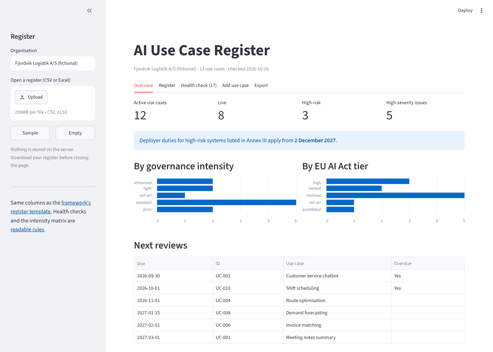
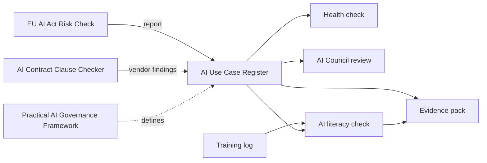

# AI Use Case Register

[](https://github.com/gifmaster/ai-use-case-register/actions/workflows/tests.yml)
[](https://ai-use-case-register.streamlit.app)

**Keep track of every AI use case in your organisation, and see at a glance where governance is missing.**

Most companies keep their AI inventory in a spreadsheet that nobody checks. This register does the checking:

- **Calculates the governance intensity** of each use case from its EU AI Act risk tier and how much the AI acts on its own, and flags entries where the recorded intensity is wrong
- **Runs a health check** on the whole register: prohibited AI still in use, live without approval, no owner, overdue reviews, high-risk without a decision on a fundamental rights impact assessment, and more
- **Imports results from the [EU AI Act Risk Check](https://ai-act-risk-check.streamlit.app)**: upload its report and the risk tier is filled in
- **Produces the AI Council's quarterly review** as a ready-to-send PDF (or Markdown)
- **Checks the AI literacy training log against the register**: no measure for all staff, enhanced or strict use cases live without a trained overseer, overdue refreshes, training without evidence (EU AI Act Art. 4, as amended by Regulation (EU) 2026/1744)
- **Builds an evidence pack** for a customer questionnaire, an auditor or an authority: use cases, impact assessment decisions, AI literacy measures and open issues in one PDF, with the register, training log and health check as annexes in a ZIP



**[Try it live](https://ai-use-case-register.streamlit.app)** with a fictional logistics company, its 13 AI use cases and its training log.

## How it fits together



The register uses exactly the same columns as the [register template](https://github.com/gifmaster/ai-governance-framework/blob/main/templates/ai-register.csv) in the Practical AI Governance Framework. A test makes sure they stay identical.

## Governance intensity

Two questions decide how much governance a use case needs: what the AI is used for (EU AI Act risk tier) and how much it acts on its own (AI Oversight Scale, 1 to 5).

| Tier / Oversight | 2 AI-Assisted | 3 AI-Collaborative | 4 AI-Embedded | 5 AI-Driven |
|---|---|---|---|---|
| Minimal | light | light | standard | enhanced |
| Transparency | light | standard | standard | enhanced |
| High risk | enhanced | enhanced | strict | **redesign** |
| Prohibited | **stop** | **stop** | **stop** | **stop** |

The matrix lives in [`schema.yaml`](src/usecasereg/rules/schema.yaml) and the 13 health checks in [`checks.yaml`](src/usecasereg/rules/checks.yaml), written so a non-programmer can read and change them:

```yaml
- id: live_without_approval
  severity: high
  title: Live without a recorded approval
  when:
    - {field: status, eq: live}
    - {field: approved_on, empty: true}
  action: Record who approved go-live and when, or take the use case back to approval.
  ref: Framework ch. 4 gate G3
```

## AI literacy and the evidence pack

The training log uses the columns of the framework's [training log template](https://github.com/gifmaster/ai-governance-framework/blob/main/templates/training-log.csv), and the plan behind it is the framework's [AI literacy plan](https://github.com/gifmaster/ai-governance-framework/blob/main/templates/ai-literacy-plan.md). Its five checks and their texts are in [`training.yaml`](src/usecasereg/rules/training.yaml). Because they compare two files, the logic is in [`training.py`](src/usecasereg/training.py), one short function per check.

Art. 4 asks for measures that support AI literacy, not a guaranteed level for each person. The checks therefore look for measures that are missing or out of date. They cannot judge whether a session was any good.

The evidence pack only summarises what the register and the log say, with the gaps the checks found. It is not an audit or a certificate, and says so on its last page.

## Where it fits

Use it as a **health check for the spreadsheet you already have**, or as a lightweight register when you have none. It is not a workflow platform: no approvals, reminders, accounts or audit trail. If you outgrow it, the Export tab writes a CSV with plain headers that is easy to map into a GRC platform's import. Mandatory registers (GDPR Art. 30, the DORA Register of Information) are separate and are not replaced by this one.

## Your data stays yours

Nothing is stored on the server. You open a register from CSV or Excel, work on it, and download it again. For real client data, run it locally.

## Run it locally

```bash
git clone https://github.com/gifmaster/ai-use-case-register.git
cd ai-use-case-register
pip install -r requirements.txt
streamlit run app.py
```

## Tests

```bash
pip install pytest
pytest
```

72 tests, including:

- the sample register has **planted problems**, and an [answer key](tests/expected_issues.yaml) states exactly which checks must fire for which use case. Every check is covered, and a check firing where it should not fails the build
- the intensity matrix, case by case
- the columns match the framework template
- CSV (comma or semicolon) and Excel round trips
- import of Risk Check reports, and app smoke tests
- a training log with planted gaps and its own [answer key](tests/expected_training_issues.yaml), the evidence pack's contents and its ZIP annexes

## Part of a toolkit

| | |
|---|---|
| [EU AI Act Risk Check](https://github.com/gifmaster/ai-act-risk-check) | Classify an AI system |
| [AI Contract Clause Checker](https://github.com/gifmaster/contract-clause-checker) | Review the vendor contract |
| This register | Keep track of all of it |
| [Regulation Navigator](https://github.com/gifmaster/regulation-navigator) | See which of the AI Act, GDPR, NIS2 and DORA apply, and where they overlap |
| [Practical AI Governance Framework](https://github.com/gifmaster/ai-governance-framework) | The method behind it |

## About

Built by **Alexander Senderovitz**, AI governance and digital transformation, Copenhagen.
[senderovitz.eu](https://senderovitz.eu) · [alexander@senderovitz.eu](mailto:alexander@senderovitz.eu)

Licensed under the [GNU AGPL-3.0](LICENSE): free to use, study and change. If you run a modified version as a service, you must share its source code. Commercial license without these terms: [alexander@senderovitz.eu](mailto:alexander@senderovitz.eu). Not legal advice.

## Experimental: run it in the browser (no server)

`python scripts/build_stlite.py` builds a static copy that runs the unchanged app inside the visitor's browser with [stlite](https://github.com/whitphx/stlite). It can be hosted for free on GitHub Pages, never goes to sleep, and uploaded files never leave the visitor's computer. The first load is slower (Python starts in the browser). This is a test next to the normal Streamlit app, not a replacement.
